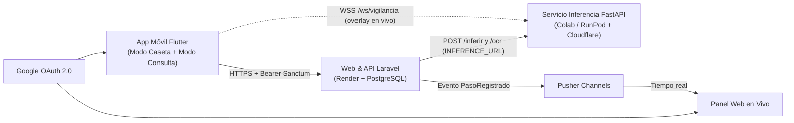

# Sistema Inteligente de Control de Peaje

Sistema integral de control de peaje basado en visión por computadora en tiempo real, compuesto por un servicio de inferencia neuronal en la nube (3 modelos), aplicación web Laravel con actualizaciones en vivo vía Pusher, agente conversacional (texto e imagen) y aplicación móvil Flutter con autenticación exclusiva mediante Google OAuth 2.0.

## Integrantes y Roles
- **Jhosue Fariñas** — Arquitectura, backend Laravel/PostgreSQL, inferencia FastAPI y aplicación móvil Flutter.
*(Completar con los demás integrantes y sus roles si aplica).*

## Arquitectura del Sistema



## Tecnologías Utilizadas
- **Inferencia IA (`inferencia/`):** Python, FastAPI, Uvicorn, WebSockets, PyTorch, Ultralytics YOLOv11 (`yolo-seg` para M2, `yolo-pose` para M3), YOLOv9 ONNX + `fast-plate-ocr` (`cct_xs_v2_global`) para M1.
- **Aplicación Web & API (`web/`):** PHP 8.3, Laravel, PostgreSQL, Laravel Socialite (Google OAuth 2.0), Laravel Sanctum, Pusher, Tailwind CSS.
- **Aplicación Móvil (`movil/`):** Flutter / Dart, `google_sign_in`, `camera`, `web_socket_channel`, `image`, `image_picker`.

## Estructura del Repositorio
- `inferencia/`: API FastAPI (`/health`, `/inferir`, `/ocr`, `/ws/vigilancia`) y pesos (`weights/`).
- `web/`: Aplicación web, API REST (`/api/v1/...`), modelos Eloquent, migraciones, seeders y agente conversacional.
- `movil/`: Aplicación móvil Android en Flutter (Login Google, Modo Caseta CCTV/captura y Modo Consulta).
- `docs/`: Especificación OpenAPI (`docs/openapi.yaml`) y colección Postman (`docs/postman_collection.json`).
- `.env.example`: Plantilla de variables de entorno sin credenciales.

## Despliegue por Componente

### 1. Servicio de Inferencia (`inferencia/`)
1. Abrir en Google Colab (con **GPU T4**) o RunPod.
2. Instalar dependencias:
   ```bash
   pip install -r inferencia/requirements.txt
   ```
3. Levantar el servidor:
   ```bash
   uvicorn main:app --host 0.0.0.0 --port 8000
   ```
4. Exponer con Cloudflare Tunnel (`cloudflared tunnel --url http://localhost:8000`) y copiar la URL generada en la variable `INFERENCE_URL` de Render.

### 2. Aplicación Web y API (`web/`)
1. Desplegar el directorio `web/` usando su `Dockerfile` en Render.
2. Configurar las variables de entorno en Render (`APP_KEY`, `DB_*` para PostgreSQL, `GOOGLE_CLIENT_ID`, `GOOGLE_CLIENT_SECRET`, `GOOGLE_REDIRECT_URI`, `INFERENCE_URL`, `PUSHER_*`).
3. El contenedor ejecuta automáticamente migraciones y seeders (`php artisan migrate --force --seed`), creando las casetas, tarifas, 20 vehículos de prueba y la lista blanca de usuarios (incluyendo `doc.alvaro.pinto.ma@unifranz.edu.bo` como `admin`).

### 3. Aplicación Móvil (`movil/`)
1. Configurar `baseUrl`, `wsVigilanciaUrl` y `webClientId` en `movil/lib/config.dart`.
2. Compilar APK:
   ```bash
   cd movil
   flutter pub get
   flutter build apk --release
   ```

## Enlaces de Producción
- **Aplicación Web (Render):** https://sistema-peaje-inteligente.onrender.com
- **Documentación API:** [docs/openapi.yaml](docs/openapi.yaml) | [docs/postman_collection.json](docs/postman_collection.json)
- **Datasets en Roboflow:** *(agregar enlace público de tus datasets M2 y M3)*
- **Endpoint de Inferencia (Colab/RunPod):** configurable mediante `INFERENCE_URL`.
